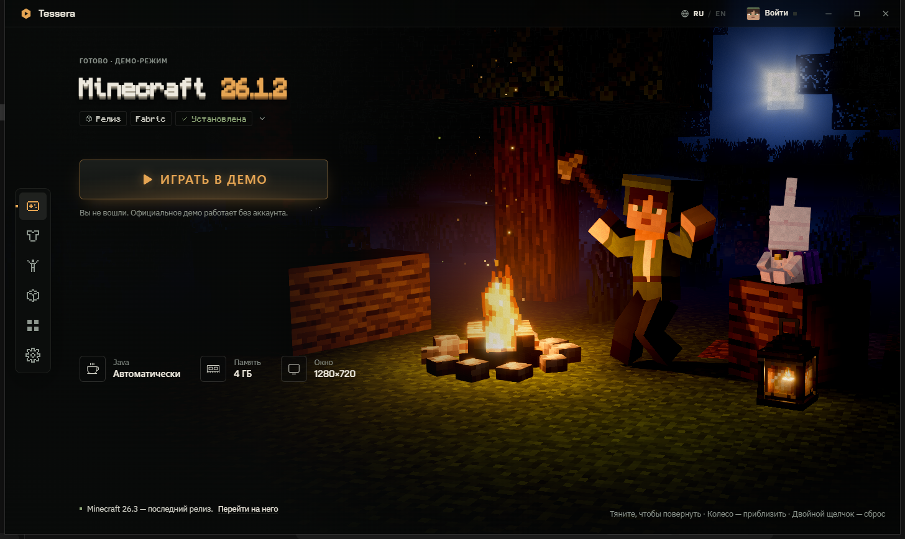

# Tessera

A free launcher for **Minecraft: Java Edition** on Windows, built around a live 3D scene with your own character.

## What it does

- **A living home screen.** Your character stands by a campfire in a night forest, wearing your skin and playing the animation you picked.
- **Microsoft sign-in.** Uses the OAuth device code flow: you sign in on Microsoft's own page and the launcher never sees your password. Session tokens are kept in the Windows Credential Manager.
- **Official game files only.** Versions are installed and started from Mojang's servers. Nothing from Mojang is bundled with the launcher.
- **Skins.** Keep a local skin library, preview skins on the 3D character, and upload the one you chose to your Minecraft profile through the official skin API, so every player sees it.
- **Builds.** Fabric builds with mods, resource packs and shaders from the Modrinth catalog.

Tessera does not provide offline or cracked accounts. Without signing in, it can only start the official demo.

## Status

Tessera is a personal, non-commercial project in development (version 0.1.0, Windows only). The source code is not published yet; this page describes the application.

Built with Tauri (Rust), React and three.js.

## Contact

Questions and reports: open an issue in this repository.

## Disclaimer

NOT AN OFFICIAL MINECRAFT PRODUCT. NOT APPROVED BY OR ASSOCIATED WITH MOJANG OR MICROSOFT.
